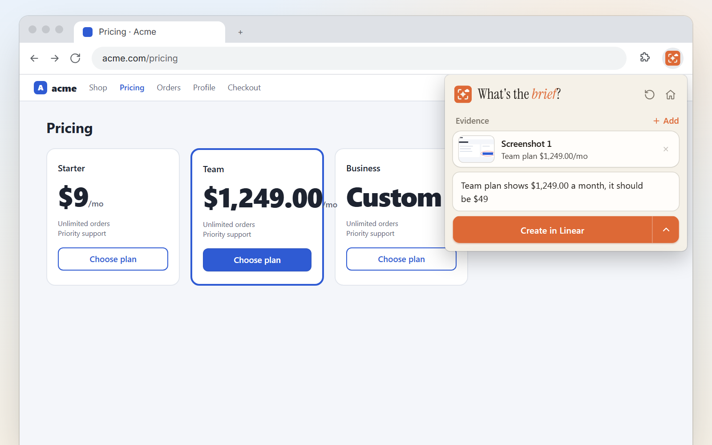
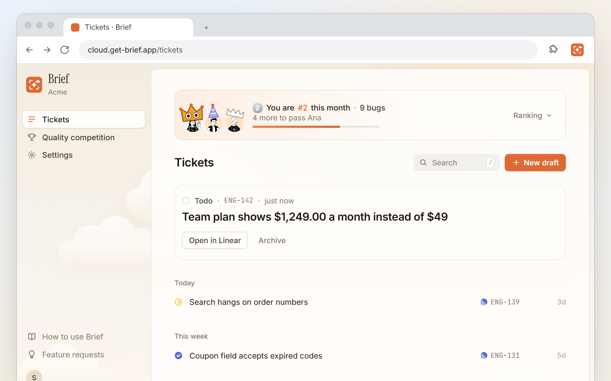

<div align="center">

# Brief

**Talk through a bug. Brief writes the ticket and files it.**

[Chrome Web Store](https://chromewebstore.google.com/detail/heekinkibhgbilagcdnmcjajijaalpcc) · [cloud.get-brief.app](https://cloud.get-brief.app) · MIT

</div>





## How it works

- **The extension** records your tab, your voice, screenshots and console errors while you show the bug.
- **The service** (a Next.js app) transcribes it, writes the ticket with steps to reproduce, and files it to Linear, Jira, GitHub, GitLab, Azure DevOps, ClickUp, Notion, Trello, Asana or Monday.
- **Your data:** the people running a Brief server can't read your tickets in its admin views, and you can host your own.

More in [ARCHITECTURE.md](ARCHITECTURE.md) and [PRIVACY.md](PRIVACY.md).

## Self-host

Paste into Claude Code (or any coding agent):

```text
Clone https://github.com/razi2001/brief and set it up for me by following SELF_HOSTING.md.
```

## Audit us

Paste into your agent:

```text
Clone https://github.com/razi2001/brief and audit it by following AUDIT.md.
```
