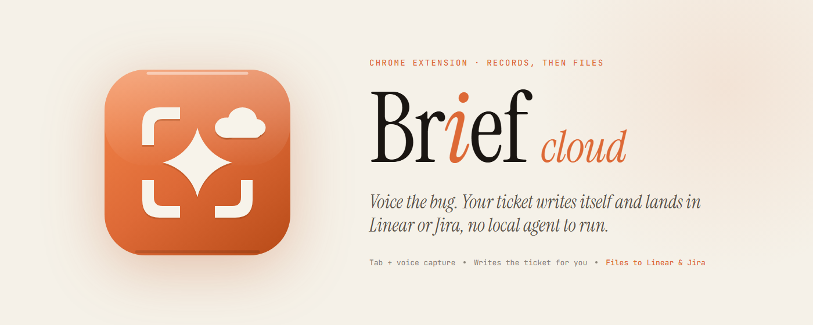
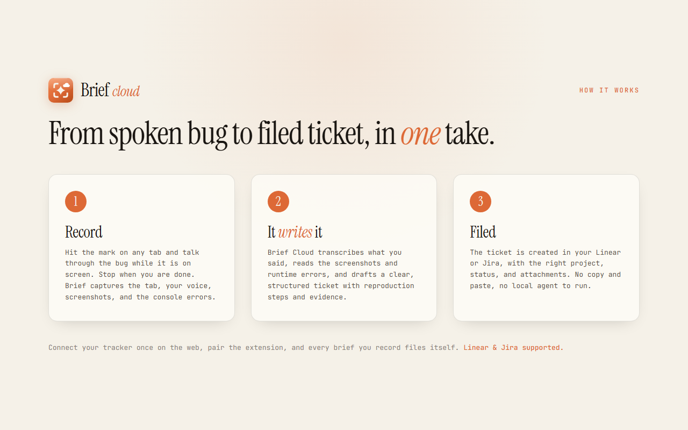
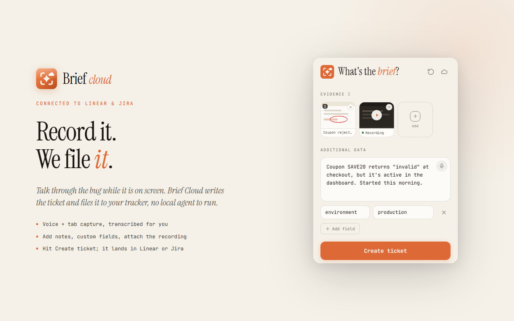

<div align="center">



# Brief

**Talk through a bug. Brief writes the ticket and files it.**

A Chrome extension and a small web app. Record your tab and your voice for thirty seconds; Brief turns it into a clear ticket with repro steps, screenshots and console errors, and files it to Linear, Jira, GitHub, GitLab, Azure DevOps, ClickUp, Notion, Trello, Asana or Monday.

[Chrome Web Store](https://chromewebstore.google.com/detail/heekinkibhgbilagcdnmcjajijaalpcc) · [Hosted: cloud.get-brief.app](https://cloud.get-brief.app) · [Self-host in 10 minutes](SELF_HOSTING.md) · [What we can see](PRIVACY.md)

MIT licensed · open source · self-hostable

</div>

---

## How it works



1. **Record.** Click ✦ on any tab and talk through the bug while it's on screen.
2. **It writes.** Brief transcribes what you said, reads the screenshots and runtime errors, and drafts a ticket with steps to reproduce and evidence.
3. **Filed.** The ticket lands in your tracker with the right project, status and attachments.



## Your data stays yours

Brief handles bug recordings, which can show customer data. So we made the privacy story checkable instead of a promise:

- **The owner views can't read tickets.** The hosted operator sees who filed how many tickets to which tracker. Never a title, text, recording or link. The columns are an allowlist in code, and CI fails if one is added. ([PRIVACY.md](PRIVACY.md))
- **You see what we see.** Every account has a *What we see* page that renders their own row of the operator's view with the same code.
- **Media is deleted after filing.** Audio and keyframes go as soon as the ticket is filed.
- **Self-host it.** One `docker compose up`, your own Supabase, Clerk and OpenAI keys. Then nobody but you holds anything. Self-hosted instances send one anonymous daily count (no content, [TELEMETRY.md](TELEMETRY.md)), off with `BRIEF_TELEMETRY=off`.

### Let your agent audit us

Paste this into Claude Code, Cursor or any coding agent:

```text
Audit the privacy claims of the open source project Brief (https://github.com/razi2001/brief-cloud).
Clone it, read PRIVACY.md, then check each claim against the code, not the docs:
1. Which database columns and fields the owner views (/admin, /admin/activity) can read:
   web/lib/admin-view.ts (OWNER_FIELDS, OWNER_COLUMNS), web/lib/admin-server.ts, web/lib/activity-server.ts.
   Look for any other code path that reads briefs across users.
2. What the activity log stores: web/lib/events.ts (pagePath, errorKind, every track() call).
3. What leaves a self-hosted instance: web/lib/telemetry.ts, web/lib/telemetry-server.ts, web/instrumentation.ts.
4. What the extension sends and to where: extension/config.js, extension/cloud.js, extension/background.js.
5. What is deleted after filing: web/lib/agent/run-processing.ts and the storage cleanup it calls.
6. Row level security: web/supabase/migrations (every public table should have RLS on).
Run the guard tests: cd web && npm ci && npx vitest run lib/admin-view.test.ts lib/events-privacy.test.ts lib/telemetry.test.ts
Report every place where the code does more than PRIVACY.md says, with file and line.
```

## Get started

| | |
|---|---|
| **Use the hosted app** | Install the [extension](https://chromewebstore.google.com/detail/heekinkibhgbilagcdnmcjajijaalpcc), sign in at [cloud.get-brief.app](https://cloud.get-brief.app), connect your tracker. |
| **Self-host** | Paste the prompt in [SELF_HOSTING.md](SELF_HOSTING.md) into Claude Code. It walks you through the keys and runs it. Or follow the manual steps there. |
| **Hack on it** | [CONTRIBUTING.md](CONTRIBUTING.md). |

## Architecture

```
Chrome extension (extension/)          Web app (web/, Next.js)                Your tracker
 records tab + voice + console  ──►     transcribes, writes the ticket   ──►   Linear, Jira, GitHub,
 uploads to signed storage URLs         with OpenAI, files it with your        GitLab, Azure DevOps,
                                        OAuth connection                       ClickUp, Notion, ...
                                              │
                         Clerk (sign-in) ─────┤
                         Supabase (Postgres + private Storage bucket)
```

| Folder | What |
|---|---|
| `extension/` | Chrome MV3 extension: capture bar, screenshot annotator, popup, uploads. Plain JS, no build step. |
| `web/` | Next.js app: API for the extension, the ticket agent (`lib/agent`), tracker clients (`lib/trackers`), dashboard. |
| `web/supabase/migrations/` | The whole database schema, applied in order by `web/scripts/migrate.mjs`. |
| `docker-compose.yml` | Self-hosting: a one-shot migrate step, then the app. |
| `docs/` | Screenshots, and the design notes features were built from. |

## License

MIT, see [LICENSE](LICENSE).
